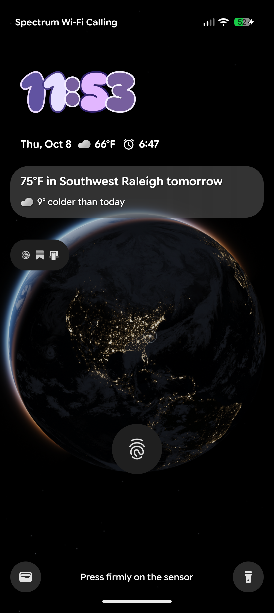

# Earth — live lock-screen wallpaper for Pixel

A real-time Earth on the Pixel lock screen: actual sun position, city lights on the night side, live satellite clouds that move with the measured wind, and a smooth spin-in every time the screen wakes. Free to run: no accounts, no servers, no paid APIs.



**For iPhone and everyone else:** the web version (same globe, same live clouds, control-mode style buttons) is at **https://kckbytes.github.io/earth-web/**. Its source is the public repo [kckBytes/earth-web](https://github.com/kckBytes/earth-web). On iPhone: Safari → Share → Add to Home Screen.

## What it does

**Globe**
- Ray-traced sphere in a GLES 3 fragment shader: day texture (NASA Blue Marble, per month), night lights (NASA Black Marble), ocean sun glint, atmosphere halo, stars, ACES tone mapping.
- Sun position from a low-precision ephemeris, so the day/night line is correct to the minute.
- Home city marker; centred on the home city.

**Live clouds**
- Global cloud map (EUMETSAT via clouds.matteason.co.uk, CC0) checked every 30 min with ETag; new imagery about every 3 h.
- `FlowEstimator` block-matches consecutive maps into a 64×32 wind field. The shader advects the clouds along it every frame (semi-Lagrangian), and a new map cross-fades in as a smooth correction.
- An unchanged map served under a new ETag (resolution switch, CDN re-encode) is detected by pixel difference, so the 3-hour baseline is kept.

**Lock-screen interaction** (no unlock needed)
- **Wake:** Earth turns eastward into place over the home city while the clouds replay the last 12 h of motion, easing into "now".
- **Flip the phone over and back:** next city.
- **Back double-tap:** zoom in / out on the city (accelerometer, 400 Hz, impulse + stillness filtered against walking).
- **Back triple-tap:** replay the cloud time-lapse.
- **Gyro parallax:** sensitivity is lower when zoomed.

**Control mode** (Quick Settings tile "Earth", opens over the lock screen)
- Only the globe plus a small button row: home, −, next city (press-and-hold = joystick), +, hold-to-fast-forward time.
- Double-tap the globe to zoom at that spot.

**Settings app:** cities (add by name, use my location, presets), size and height on screen, motion toggles, tilt sensitivity, cloud refresh.

**Cost:** renders only while the lock screen is visible, with sensors off when the screen is off. About 30 % GPU duty at low clock while being looked at: two-pass render, an 80 % FBO, and 30/60 fps idle/tilt frame pacing.

## Build (Windows, no Gradle)

The raw SDK tools live in `%USERPROFILE%\android-dev` (JDK, build-tools 37.0.0, platform android-37.0, platform-tools).

```powershell
powershell -ExecutionPolicy Bypass -File build.ps1      # aapt2 -> javac -> d8 -> zipalign -> apksigner => Earth.apk
adb -d install -r Earth.apk
```

- `tools/apply.ps1 <ver> "File.java=md5;..."` verifies incoming files by MD5, copies them in, builds, installs, and prints the wallpaper state.
- `earth.keystore` is **not** in the repo. Keep a private backup: installing an update signed with a different key requires uninstalling, which resets the wallpaper.

## Layout

```
app/
  AndroidManifest.xml
  assets/      globe.vert, globe.frag, label.frag, day/ (12 monthly textures), lights.jpg, water.jpg, clouds.jpg (fallback)
  res/         icons, tile icon, wallpaper metadata
  src/com/chai/earthwall/
    EarthWallpaperService.java   wallpaper engine, sensors (parallax, flip, back taps), wake/sleep
    GlobeThread.java             render thread, camera, wake animation, zoom, time-lapse, explore controls
    GlobeRenderer.java           GL setup, textures, two-pass draw, cloud slots
    CloudUpdater.java            cloud download, change detection, motion estimation, cache
    FlowEstimator.java           block-matching wind field (RG8 64x32)
    Astro.java                   sun position, GMST, view matrices
    Prefs.java                   settings + screen layout
    SettingsActivity.java        launcher / settings UI
    ExploreActivity.java         control mode over the lock screen
    CityStickButton.java         tap = next city, hold = joystick
    EarthTileService.java        Quick Settings tile
build.ps1
tools/
  apply.ps1, fetch_textures.py, prep_textures.py, probe_feeds.ps1
  preview/   WebGL2 copy of the renderer for checking looks on a PC before touching the phone
  dev/       laptop helper scripts (phone control, GPU measurement, emulator)
docs/
  ROADMAP.md
```

## Credits
- NASA Visible Earth: Blue Marble Next Generation, Black Marble.
- EUMETSAT cloud imagery via [clouds.matteason.co.uk](https://clouds.matteason.co.uk) (CC0).
- Open-Meteo (weather; code present in control mode, currently unused).

Device: Pixel ("grizzly"), Android 17, 1280×2856.
